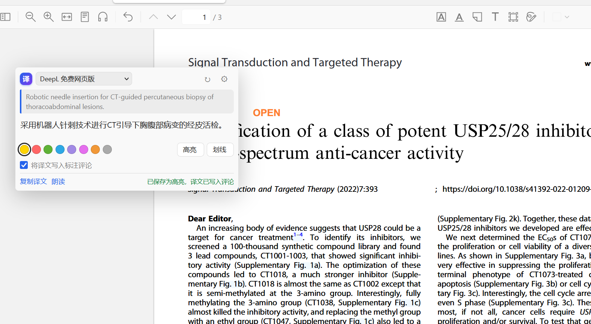
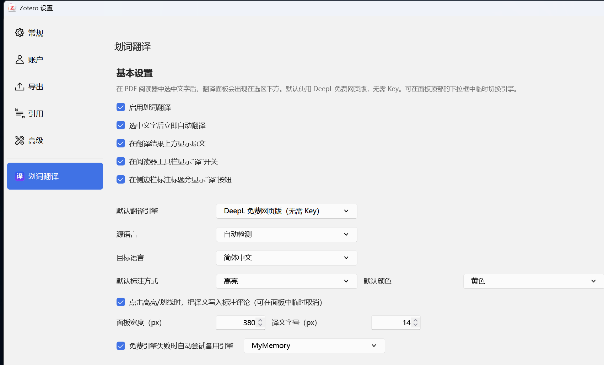

# Zotero划词翻译 · Zotero Selection Translator · 支持免费版Deepl专业翻译

一个面向 Zotero 7+ 的 PDF/EPUB 划词翻译插件。在阅读器里选中文字，翻译面板会直接出现在选区下方；可以一键高亮/划线，并把译文写入标注评论。**为避开默认使用非官方接口带来的利益冲突，插件默认不调用任何翻译服务，首次使用时需主动选择渠道**；所有原有渠道均保留：DeepL 免费网页版、DeepL API、Google、MyMemory、百度、Microsoft、LibreTranslate，以及 OpenAI 兼容 / DeepSeek / Anthropic / Gemini 等 AI 模型。

当前版本：**1.8.2 Beta**（免责声明可收起、自适应状态栏、五种主题 + 跟随系统、词典字体统一、渠道下拉框可调宽等，详见下文）。

> **仅供个人学习、研究和技术交流使用。** 严禁将本插件用于任何损害他人或单位合法权益、侵犯知识产权、违反法律法规或第三方服务条款的用途；如需商用，请自行取得相关权利方的授权。作者不提供商业授权、质量保证或合规背书。

项目主页：<https://github.com/all11250/zotero-selection-translator>



> 截图为早期版本，1.8.2 Beta 新增了单词词典卡片、连续翻译按钮、自动尺寸、五种主题和可收起免责声明。

## 功能

- **划词即译**：在 PDF/EPUB 阅读器中选中文字后，自动在选区下方显示翻译；也可以关闭自动翻译，点击按钮再请求。
- **单词词典**：选中单个英文单词时自动切换为词典卡片，显示词性、中文释义、英文释义（可选）以及美式/英式音标；点击音标即可朗读。支持必应词典、有道词典、牛津学习者词典、Free Dictionary API（Wiktionary）和 AI 词典，可单选也可「自动」依次回退。
- **连续翻译**：译文区右上角、置顶按钮左边的「连续翻译」按钮，开启后卡片自动置顶；之后在不同位置（包括翻页后）继续划词，会把新选区追加到同一张卡片里，两段之间自动补一个空格。**每次追加后，插件会等待约 0.65 秒再把你已划取的全部原文合并后重新提交给翻译引擎**，而不是把每一句单独翻译后拼接，因此同一段话的译文不会割裂；连续快速划取时只发送最后一次合并结果。
- **卡片自动尺寸**：翻译/词典结果返回后，卡片会按内容自动加宽、加高，尽量完整显示译文；自动尺寸上限为阅读器窗口宽度的一半、高度的一半（即面积不超过窗口的 1/4），超过后由用户手动拖动边框/角落调整。用户手动调整过大小后，自动尺寸不再覆盖。
- **自适应状态栏**：卡片右下角的状态提示会随卡片宽度伸缩——卡片拉长后逐渐显示完整文字，卡片较窄时自动截断并显示省略号，不会一直只显示固定的一小段。
- **五种主题 + 跟随系统**：卡片支持与 Zotero 阅读器一致的原始、深色、黑色、雪色、棕褐五种主题；设置页可选择“跟随系统 / Zotero 主题”，卡片会在 Zotero 主题切换时自动响应。卡片顶部字号按钮左侧新增主题按钮，使用太阳、鲸鱼、月亮、雪花、木桩五种**简约线条 SVG 图标**，点击循环切换；主题只改变颜色，译文与词典仍保持中文宋体、英文/数字 Times New Roman。
- **词典字体与译文统一**：词典卡片与译文共用同一个“学术字体”开关（中文宋体 / 英文 Times New Roman），没有单独的词典字体按钮。
- **渠道下拉框可调宽**：卡片顶部翻译引擎下拉框右侧可拖动拉宽/缩窄，最短约 6 个中文字符；在卡片宽度未改变时，最长不会超过右侧主题按钮的位置。
- **免责声明可收起**：设置页顶部免责声明卡片右下角有「我已知晓」按钮，点击后收起到只显示一行“仅供学习使用…”的摘要，按钮变为「收起」；再次点击可展开。状态会保存，不会在每次打开设置时反复展开。
- **低内存实现**：翻译缓存上限降为 120 条、词典缓存降为 150 条（仍只在内存中、退出即清空）；主题切换只修改 CSS 变量，主题观察器全局共用一个，跟随系统的媒体监听仅在置顶卡片上存在并在关闭时移除。
- **清空内容**：卡片底部「清空」按钮始终可用于清空原文和译文（包括关闭连续翻译之后）；清空后继续划词即可重新开始。
- **默认置顶**：设置中可开启「划词翻译卡片默认置顶」，首次划词即固定卡片，直到手动关闭置顶。
- **直接标注**：面板内选择颜色，点击「高亮」或「划线」即可创建 Zotero 标注。
- **译文进评论**：勾选「将译文写入标注评论」后，译文会写入该标注的评论；再次点击会更新同一条标注，不会重复创建。连续翻译时评论会包含当前卡片的完整译文。
- **多种引擎**：DeepL 免费网页版、DeepL 官方 API、Google 翻译、MyMemory、百度翻译、Microsoft Translator、LibreTranslate。
- **AI 翻译**：支持 OpenAI 兼容接口（OpenAI、通义千问、Kimi、硅基流动、Ollama、LM Studio 等）、DeepSeek 专属接口、Anthropic Claude、Google Gemini。
- **学术提示词**：AI 翻译默认使用学术翻译提示词；可选择性附带论文标题/摘要作为术语上下文，减少专有名词误译（默认关闭，避免把摘要发送给第三方）。
- **阅读器工具栏开关**：工具栏「译」按钮可快速开关自动翻译。
- **侧边栏标注翻译**：打开标注侧边栏后，每条高亮/划线标题旁有「译」按钮，可把该标注翻译后追加到评论。
- **译文操作**：复制译文、浏览器朗读、重新翻译、切换引擎、错误详情与重试。
- **字号与行距**：译文字号支持 8–48 px 自定义输入，行间距支持 1.0–3.0 倍；设置面板和翻译面板顶部的「Aa」都可以调整。
- **原文预览**：原文区域可上下滚动，鼠标拖动其右下角可以调高/调低显示高度。
- **置顶常驻**：译文右上角「置顶」按钮可把翻译框固定在阅读器页面上，不随选区消失。
- **置顶接管划词**：置顶后，后续划词不再弹出新的翻译卡片，而是直接更新置顶卡片中的原文和译文；关闭置顶卡片后恢复选区弹窗。
- **拖动与缩放**：置顶后按住卡片顶部空白处即可拖动；四条边框和四个角都可调整宽高，拖动/缩放使用 `requestAnimationFrame` 节流。1.8.0 起缩放热区不再显示蓝色圆点/边框小条，并修复了从左上、左下角缩放时误拖动整张卡片的问题。
- **学术字体**：可让译文中文使用宋体、英文/数字使用 Times New Roman（默认开启）。
- **中文原文跳过翻译**：源语言为简体/繁体中文，或自动检测到选区是中文时，不调用任何翻译接口，也不显示插件翻译卡片，只使用 Zotero 原生的划线/高亮功能。
- **缓存与回退**：相同文本/语言/引擎的译文和词典结果仅在内存中缓存，退出 Zotero 自动清空，不占用磁盘空间；设置页可立即手动清空。免费引擎失败时的自动回退默认关闭，可在设置中显式开启。

## 安装

### 直接安装（推荐）

1. 打开 Zotero。
2. 菜单 **工具 → 插件**（macOS：**Zotero → 设置 → 插件**）。
3. 点击右上角齿轮 → **Install Add-on From File…**。
4. 选择从 [Releases](https://github.com/all11250/zotero-selection-translator/releases) 下载的 `.xpi` 文件（本版本为 v1.8.2-beta，尚未发布时请从本地 `dist/` 安装）。
5. 按提示重启 Zotero。

> `.xpi` 就是 Zotero 的插件安装包；不需要解压，也不要把它改成 `.zip` 后安装。

### 从源码构建

需要 Node.js（只用于语法检查/静态测试）和 PowerShell 5.1+：

```powershell
git clone https://github.com/all11250/zotero-selection-translator.git
cd zotero-selection-translator
powershell -ExecutionPolicy Bypass -File scripts/build.ps1
```

构建产物：

```text
dist/zotero-selection-translator-1.8.2-beta.xpi
dist/zotero-selection-translator.xpi
dist/SHA256SUMS.txt
```

> `manifest.json` 的 `update_url` 指向本仓库 `main` 分支的 `update.json`。发布新版本时请同步更新该文件中的版本号、下载地址和哈希。

静态检查：

```powershell
node test/smoke.mjs
powershell -ExecutionPolicy Bypass -File scripts/validate.ps1
```

## 快速使用

1. 用 Zotero 打开一篇 PDF。
2. 用鼠标选中一段英文（或其他语言）。
3. 首次使用时，面板会提示「尚未选择翻译渠道」；请在卡片顶部下拉框主动选择一个渠道（也可以先在设置中选好默认渠道）。**插件不会自动调用任何服务。**
4. 选择渠道后才会发起翻译；等待翻译完成。
5. 选择颜色，决定是否勾选「将译文写入标注评论」。
6. 点击「高亮」或「划线」保存标注。
7. 在右侧/左侧标注侧边栏可以看到该标注；评论中就是译文。

打开 **工具 → 划词翻译设置…** 可以配置渠道、语言、标注默认值、译文字号/行距、词典和 AI API。

### 单词词典

当选区是一个英文单词（允许连字符、撇号和少量首尾标点）且「单词划词时显示词典释义」开启时，面板切换为词典模式：

- 顶部显示单词、美式/英式音标；音标本身就是按钮，点击朗读（优先使用词典提供的音频，失败时回退到系统语音合成）。
- 中间按词性分组显示中文释义；牛津/Wiktionary 这类只有英文释义的词典会显示英文释义，并调用当前翻译引擎补一条中文翻译。
- 底部显示「释义来源」和「在浏览器中打开」链接，保留词典品牌与来源。
- 面板顶部下拉框可在词典来源之间切换；选「整句翻译」可把当前单词按普通文本翻译。普通翻译模式下，选中单词时也可通过底部的「查词典」切回词典。
- 支持来源：**请选择词典来源（默认不查询）**、自动（有道 → 必应 → 牛津 → Free Dictionary）、必应词典、有道词典、牛津学习者词典、Free Dictionary API、AI 词典。所有来源均保留，需用户主动选择后才会发起查询。
- AI 词典使用「词典查询 → AI 词典使用」里选择的 AI；默认「自动」表示当前翻译引擎是 AI 就用它，否则用 DeepSeek。AI 提示词要求返回 JSON（词性 + 中文释义 + 可选音标），解析失败时会提示错误并允许重试或改用整句翻译。
- 首次选中单词时，如果还没有选择词典来源，卡片只会显示「尚未选择词典来源」提示，**不会自动查询任何词典**；在顶部下拉框选择来源后立即查询。

**词典来源与合规提示**

| 来源 | 类型 | 数据 | 风险提示 |
|---|---|---|---|
| 有道词典 | 公开 JSON 接口 | 美/英音标、词性、中文释义、发音 | 非官方读取；服务条款禁止自动化抓取，仅供个人低频使用 |
| 必应词典 | 公开网页 | 美/英音标、词性、中文释义、发音 | 非官方读取；Microsoft 条款限制自动抓取 |
| 牛津学习者词典 | 公开网页 | 美/英音标、词性、英文释义、发音 | 非官方读取；释义受版权保护，条款/robots 对自动访问有限制 |
| Free Dictionary API | 开放 API（Wiktionary 数据） | 英文释义、部分音标/音频 | 数据为 CC BY-SA，界面保留来源链接与许可说明 |
| AI 词典 | 你自己的 AI Key | 词性、中文释义、可选音标 | 结果由模型生成，仅供参考；会产生 API 费用 |

插件只按“一次一个单词”查询，不批量预取、不爬取整页，并会做会话内缓存；但仍请自行判断所在地区/用途下的合规性。**需要商用或稳定服务时，请购买对应词典/翻译服务的官方 API。**

### 连续翻译

1. 先正常划词翻译一段文字。
2. 点击译文区右上角、**置顶按钮左边**的「连续翻译」按钮。按钮变为「连续中」，卡片自动置顶。
3. 翻到下一页或滚动到别处，继续选中同一段落的后续文字；新内容会自动追加到卡片：
   - 原文：`第一段 第二段 第三段`（确保中间有且只有一个空格，不会把前后单词粘在一起）；
   - 译文：由引擎对**合并后的完整原文**重新翻译，而不是把几句独立译文拼在一起。
4. 每次追加后等待约 0.65 秒再提交；如果在这段时间内又划取了新内容，只发送最后一次合并结果。翻译完成后，卡片会显示当前完整译文。
5. 点击「清空」可清空已拼接的原文和译文，继续划词即可重新开始；**关闭「连续翻译」后「清空」按钮仍然可用**。关闭连续翻译只停止追加/合并，已生成的内容保留。

说明：

- 连续翻译开启时，新选区会自动翻译，不受「选中文字后立即自动翻译」开关影响。
- 连续翻译至少需要两次划取才能体现“合并后重译”；第一段若已翻译，第二段起会连同第一段一起重新翻译。
- 如果第一段还没翻译就开启了连续翻译，会立即/在下次追加时翻译合并后的文本，避免出现“有原文没译文”。
- 高亮/划线保存的是最后一次选区，评论中写入当前卡片的完整译文。
- 连续翻译依赖置顶卡片；关闭置顶会移除卡片并结束本次连续翻译。
- 中文选区仍会被跳过，不会追加。
- 合并翻译失败时会回滚最后一次追加，避免原文和译文不一致；可重新划取或清空重试。

### 默认置顶

设置 → 基本设置 → 勾选「划词翻译卡片默认置顶」后，第一次划词生成的卡片会自动置顶；后续划词更新这张卡片，直到点击「关闭置顶」。

### 调整字号、行间距和字体

- **设置面板**：基本设置 → 译文字号（8–48 px，可直接输入任意值）、译文行间距（1.0–3.0 倍，支持 0.05 步进）。
- **翻译面板**：点击面板顶部「Aa」按钮，展开字号/行距输入框，立即作用于当前译文；修改会保存为后续默认值。
- **学术字体**：设置中勾选「译文中文使用宋体，英文/数字使用 Times New Roman」后，译文会使用 `"Times New Roman", "SimSun", "宋体", ...` 字体栈：英文/数字优先 TNR，中文字符回退到宋体。该选项默认开启。

### 中文原文

当源语言设置为简体中文/繁体中文，或「自动检测」判断选区为中文时，插件会直接跳过翻译请求：

- 不显示插件翻译卡片
- 不调用 DeepL / AI / 其他翻译接口
- 使用 Zotero 原生的颜色、高亮和下划线功能
- 置顶卡片存在时也不会用中文选区更新它

### 翻译缓存

- 相同文本、源/目标语言和引擎的译文，以及相同单词/来源的词典结果，只在当前 Zotero 会话的内存中缓存。
- 不写入磁盘、不写 `storage`，退出 Zotero 或禁用插件时自动清空。
- 设置页提供「立即清空翻译缓存」按钮，可随时手动释放译文和词典缓存。

### 原文预览 / 置顶 / 拖动 / 缩放

- **原文预览**：鼠标放在原文框内可用滚轮上下滚动；拖动原文框右下角可以调整高度。
- **置顶**：点击译文区域右上角的「置顶」按钮，翻译框会固定到阅读器页面上；按钮变为「关闭置顶」。置顶期间后续划词会直接更新这张卡片，不再在选区下方生成新卡片。
- **关闭置顶**：点击「关闭置顶」会移除常驻卡片，之后的划词恢复为选区弹窗翻译。
- **拖动**：置顶后，按住卡片顶部空白处（logo、空白区域）即可拖动；不要按住下拉框或按钮。
- **缩放**：置顶后，卡片的上、下、左、右四条边以及四个角都可以拖动调整尺寸；最小约 260×180 px。拖动和缩放使用 `requestAnimationFrame` 合并高频事件，减少卡顿。缩放热区是透明的，不再显示蓝色圆点/边框小条。

### 卡片自动尺寸

- 翻译或词典结果返回后，卡片会按内容量自动加宽、加高，尽量把译文完整显示出来；译文较长时不再只显示固定 280 px 高度。
- 自动尺寸上限：宽度不超过阅读器窗口的 **1/2**，高度不超过窗口的 **1/2**（因此卡片面积最多约为窗口的 1/4）。超过上限的内容在卡片内滚动。
- 需要比上限更大时，用户可手动拖动边框/角落调整；**一旦手动调整过大小，后续翻译不会覆盖你的尺寸**。
- 置顶卡片和未置顶的划词卡片都会应用自动尺寸；词典卡片同样受上限约束。

### 状态栏

- 卡片右下角的提示文字不再是固定宽度：卡片越宽，状态栏可用空间越大，会逐步显示完整提示；卡片较窄时用省略号截断，并可通过悬停查看完整内容。

### 主题样式

- 设置 → 基本设置 → **主题样式**：可选择「跟随系统 / Zotero 主题」或固定为原始、深色、黑色、雪色、棕褐五种之一。
- 翻译卡片顶部、`Aa` 字号按钮左边有主题按钮，使用**简约线条 SVG 图标**（太阳 / 鲸鱼 / 月亮 / 雪花 / 木桩），点击在五种主题间循环切换。
- 主题颜色取自 Zotero 阅读器的对应主题（背景/前景），切换时只修改 CSS 变量，不重建 DOM；中文宋体、英文/数字 Times New Roman 的字体设置不受影响。
- 「跟随系统 / Zotero 主题」会监听 Zotero 阅读器主题设置和系统深浅色变化；置顶卡片会即时更新，普通弹窗卡片在下次打开时应用。

### 渠道下拉框宽度

- 把鼠标放在卡片顶部翻译引擎下拉框的右侧边缘，出现左右拖动光标后即可拉宽或缩窄。
- 最短约 6 个中文字符；卡片宽度没有变化时，最长不会超过右侧主题按钮的位置。
- 宽度会保存为默认值；卡片变宽后可继续拉长，变窄时会自动收敛到可用上限。

### 免责声明收起

- 设置页顶部免责声明卡片右下角提供「我已知晓」按钮。
- 点击后免责声明收起为一行“仅供学习使用……”摘要，按钮文字变为「收起」；再次点击「收起」可重新展开。
- 收起状态会保存到本机预置项，下次打开设置时保持。



> 设置页截图为早期版本；1.8.2 Beta 顶部免责声明可收起，并新增「主题样式」「词典查询」「默认置顶」等选项。

## 翻译引擎

| 引擎 | 是否需要 Key | 说明 |
|---|---|---|
| **请选择渠道（默认）** | — | **默认不调用任何翻译服务**，避免默认使用非官方接口带来的利益冲突；用户主动选择下方任一渠道后才会发起请求。 |
| DeepL 免费网页版 | 否 | 调用 deepl.com 网页端使用的匿名 oneshot 接口，无需注册；**非官方接口**，可能限流、违反服务条款或随 DeepL 更新失效。 |
| DeepL API | 是 | 官方稳定接口。Free Key 以 `:fx` 结尾，自动走 `api-free.deepl.com`；Pro Key 走 `api.deepl.com`。 |
| Google 翻译 | 否 | 使用 `translate.googleapis.com` 的免费 gtx 接口；**非官方接口**，部分地区/网络可能不可达。 |
| MyMemory | 否 | 免费，单次约 500 字符；填邮箱可提高每日额度。请注意其公开数据/存储条款。 |
| 百度翻译 | 是 | 需要百度翻译开放平台的 AppID + 密钥；使用 `md5(appid+q+salt+key)` 签名。 |
| Microsoft Translator | 是 | 需要 Azure Translator Key，可选 Region。 |
| LibreTranslate | 视实例 | 可填公共实例或自建地址；公共实例通常需要 API Key。 |
| AI · OpenAI 兼容 | 通常是 | 兼容 OpenAI Chat Completions；本地 Ollama/LM Studio 可留空 Key。 |
| AI · DeepSeek | 是 | DeepSeek 专属配置（地址 / Key / 模型独立保存），不会覆盖 OpenAI 配置。 |
| AI · Anthropic Claude | 是 | 使用 Messages API；已加 `anthropic-dangerous-direct-browser-access` 头。 |
| AI · Google Gemini | 是 | 使用 `generateContent`。 |

### DeepL 免费网页版说明

插件**不会默认**调用 DeepL；只有你主动选择「DeepL 免费网页版」后，才会使用 DeepL 网页端使用的匿名接口：

```text
POST https://oneshot-free.www.deepl.com/v1/translate
```

它不需要 Key，但有 **1500 字符/请求** 的限制，插件会自动按句子边界切分到约 1200 字符再逐段翻译。该接口属于非官方接口，DeepL 可能随时调整或限流；如果需要长期稳定使用，请申请 DeepL API Free Key，并在设置中选择「DeepL API」。

如果 DeepL 返回 403/429，插件会显示明确错误。免费接口失败时可以在设置里开启「免费引擎失败时自动尝试备用引擎」，备用引擎是 MyMemory 或 Google；开启意味着同一段文本会发送给第二个服务商，默认关闭。

## AI 配置示例

在 **工具 → 划词翻译设置… → AI 模型** 中填写。接口地址可以填 Base URL，也可以填完整请求地址；插件会自动补全 `/v1/chat/completions`（已包含则不重复添加）。

| 服务 | API 地址 | 模型示例 | Key |
|---|---|---|---|
| OpenAI | `https://api.openai.com/v1` | `gpt-4o-mini` | 必填 |
| DeepSeek | `https://api.deepseek.com` | `deepseek-chat` | 必填 |
| 通义千问（兼容模式） | `https://dashscope.aliyuncs.com/compatible-mode/v1` | `qwen-plus` | 必填 |
| 硅基流动 | `https://api.siliconflow.cn/v1` | `deepseek-ai/DeepSeek-V3` | 必填 |
| Ollama | `http://localhost:11434/v1` | `qwen2.5:7b` | 留空 |
| LM Studio | `http://localhost:1234/v1` | 本地模型名 | 留空 |
| Anthropic | `https://api.anthropic.com/v1/messages` | `claude-sonnet-4-5` | 必填 |
| Gemini | `https://generativelanguage.googleapis.com/v1beta` | `gemini-2.0-flash` | 必填 |

DeepSeek 有独立的「DeepSeek 专属接口」配置区：地址、Key、模型、Temperature 都单独保存，不会覆盖 OpenAI 兼容配置。官方地址可填 `https://api.deepseek.com` 或 `https://api.deepseek.com/v1`；模型常用 `deepseek-chat`（通用）或 `deepseek-reasoner`（推理）。然后在翻译引擎下拉框选择 **AI · DeepSeek** 即可。

AI 翻译提示词支持占位符：

- `${text}`：选中文本
- `${sourceLang}` / `${targetLang}`：源/目标语言
- `${title}` / `${abstract}`：论文标题/摘要
- `${context}`：标题+摘要上下文

AI 词典提示词支持 `${word}`、`${targetLang}`，默认要求模型只返回 JSON。

## 工作方式与兼容性

- 通过 `Zotero.Reader.registerEventListener("renderTextSelectionPopup", ...)` 把面板同步插入选区弹窗；网络请求异步进行，不阻塞阅读器。
- 单英文单词会走 `dictionary.js` 的词典查询；其他文本走翻译引擎。
- 标注通过 `Zotero.Annotations.saveFromJSON()` 保存；类型为 `highlight` 或 `underline`，颜色为 Zotero 调色板中的小写十六进制值。
- 保存标注时**不传**当前 reader 的 `_instanceID`，因此打开的阅读器会通过 notifier 自动刷新并显示新标注。
- 已在 Zotero 10.0.8（Windows）上验证：面板注入、DeepL 免费翻译、高亮+评论保存、工具栏按钮、侧边栏按钮、设置面板加载、MyMemory 翻译。
- v1.3.0 在隔离的 Zotero 10.0.8 测试配置中自动验证：工具栏只生成一个「译」按钮；长原文的滚动高度大于可视高度；置顶/取消置顶、四角缩放均通过；设置页字号/行间距字段可正常读取。
- v1.8.0-beta 在隔离的 Zotero 10.0.8 配置中用合成 PDF 自动验证：必应/有道/牛津/Free Dictionary/自动模式/AI 词典错误处理、美英音标按钮、默认置顶、8 个缩放热区、左上/左下角缩放不再拖动卡片、缩放热区无视觉高亮、连续翻译的追加/清空/重启、中文跳过、设置面板新控件加载。
- v1.8.1-beta 进一步自动验证：词典发音状态在播放结束后恢复（不再停留在“正在朗读…”）；连续两次快速划取只向引擎发送一次合并后的完整文本；关闭连续翻译后「清空」仍可用；自动尺寸在 1001×527 的阅读器窗口中达到上限 500×263（正好为窗口面积 1/4）；三个顶部图标按钮 flex 居中；设置页免责声明渲染正常。
- v1.8.1-beta 中性默认渠道验证：新配置下首次划词只显示「尚未选择翻译渠道」，不会发起翻译请求；单单词划词只显示「尚未选择词典来源」，不会查询词典；用户从卡片顶部主动选择渠道后才会请求，且所有原渠道均保留。
- v1.8.2-beta 自动验证：免责声明「我已知晓 → 收起」折叠/展开及状态持久化；主题按钮为 24×24 线条 SVG、循环五种主题并改变卡片背景；词典正文字体与译文一致（Times New Roman + SimSun）；状态栏随卡片变宽而变宽；渠道下拉框右侧拖动可缩短到约 127px、最长收敛到主题按钮前（≤ 217px）；自动尺寸、连续翻译、发音恢复、默认渠道等回归通过。
- 理论支持 Zotero 7+；`manifest.json` 的 `strict_max_version` 目前为 `10.*`。Zotero 11 发布后如仍兼容，可自行把该字段改为 `11.*`。

## 隐私与安全

- 插件没有遥测、统计或远程配置；不会上传整篇 PDF。
- 只有你选中的文本会发送给当前选择的翻译服务：
  - DeepL 免费网页版 / DeepL API → deepl.com
  - Google → Google
  - MyMemory → mymemory.translated.net
  - 百度 → fanyi-api.baidu.com
  - Microsoft → api.cognitive.microsofttranslator.com
  - LibreTranslate → 你填写的实例
  - AI → 你填写的 API 地址
- 使用词典时只发送单个单词：有道/必应/牛津/Free Dictionary 分别发送到对应站点；牛津和 Free Dictionary 会额外调用一次当前翻译引擎来补中文。AI 词典会把单词和词典提示词发送给你选择的 AI。
- 如果开启「失败时自动尝试备用引擎」，同一段文本会发送给备用服务商；如果开启「论文标题和摘要作为术语上下文」，标题/摘要会随 AI 翻译请求发送。两项默认关闭。
- API Key 保存在本机 Zotero 配置（profile 的 `prefs.js`）中，是明文存储；请使用限额 Key，不要使用主账号的高权限密钥。
- 翻译/词典请求由 Zotero 的网络栈发出，会遵循 Zotero/系统代理设置。

### 合规与第三方服务声明

> **重要：设置页顶部有醒目的《仅供学习使用 · 重要声明与免责声明》，请在使用前阅读。** 本插件仅供个人学习、研究和技术交流使用；严禁用于任何损害他人或单位合法权益、侵犯知识产权、违反法律法规或第三方服务条款的用途。继续使用即表示你已理解并同意自行承担相关风险。

- 本插件是独立第三方开源工具，不是 DeepL、Google、Microsoft、有道、必应、牛津等任何厂商的官方产品，与其没有隶属、合作、赞助或背书关系，也未获得其授权。
- DeepL 免费网页接口、Google 免费接口以及网页词典读取都属于**非官方通道**，可能违反对应服务的服务条款（例如禁止自动化访问、禁止绕过官方 API、内容用于训练等），也可能随时失效。请优先使用官方 API Key；是否使用非官方通道及其后果由使用者自行判断和承担。
- 词典释义、音标、发音的版权归各词典/数据提供方所有；界面保留来源名称和链接，请勿移除品牌标识，也不要用于批量抓取或商业再分发。
- 译文与 AI 词典结果均为机器生成，可能存在错误，仅供阅读辅助，不应作为正式引用或专业结论。
- 如果你所在机构或地区对数据出境、论文保密有要求，请先确认所选翻译/词典服务的数据政策，或改用本地模型/自建 LibreTranslate。
- **免责声明与责任限制：** 本插件仅供个人学习、研究和技术交流使用，按“现状”提供，不附带任何明示或默示担保；严禁用于任何损害他人或单位合法权益、侵犯知识产权、违反法律法规或第三方服务条款的用途。在适用法律允许的最大范围内，插件作者及贡献者不对因使用或无法使用本插件而产生的任何直接或间接损失、数据丢失、账号封禁、服务中断、译文/词典/AI 结果错误、版权或合规问题承担责任。请谨慎使用；处理敏感数据、商用、公开发布或正式学术引用前，请自行核验结果、取得必要授权并遵守所在地区法律与第三方服务条款。如不同意，请停止使用并卸载本插件。

## 常见问题

**面板没有出现？**
- 确认 **工具 → 划词翻译设置… → 启用划词翻译** 已勾选。
- 确认当前是 PDF/EPUB 阅读器，且 PDF 不是只读状态。
- 某些快照/网页阅读器没有标准文本选择弹窗，插件会退化为不显示。

**划词后提示“尚未选择翻译渠道”？**
- 这是 1.8.1 起的默认行为：插件为避开利益冲突，默认不调用任何翻译服务。
- 在翻译卡片顶部下拉框选择渠道，或在 **工具 → 划词翻译设置… → 默认翻译渠道** 中提前选择。
- 所有原有渠道均保留，可随时切换；不选择时只会显示提示，不会发出翻译请求。

**单词没有出现词典？**
- 确认「单词划词时显示词典释义」已勾选，且选区确实是单个英文单词（不含空格）。
- 首次使用会提示「尚未选择词典来源」，这是为避免默认查询的利益冲突；在卡片顶部下拉框选择来源后才会查询。
- 「自动」会依次尝试有道、必应、牛津、Free Dictionary。若都失败，可切换来源或改用「整句翻译」。
- 词典网页可能临时改版/限流；点击「重试」或稍后再试。

**词典音标点不动/没有声音？**
- 有音频 URL 时会优先播放词典发音；播放失败会自动下载音频并重试，仍失败则回退到系统语音合成。
- 1.8.1 起，播放结束/失败后底部的「正在朗读…」会自动恢复为词典释义状态，不会一直卡住。
- 系统没有安装英语语音时可能无声，可在操作系统里安装英语 TTS 语音；若词典本身没有音频且系统无语音，会提示“当前环境不支持朗读”。

**连续翻译没有追加？**
- 确认按钮显示「连续中」，且卡片处于置顶状态。
- 仅在置顶卡片存在时追加；关闭置顶会结束连续翻译。
- 中文选区会被跳过。
- 追加后请等待约 0.65 秒的合并延迟；快速连续划取时只会提交最后一次合并文本。

**关闭连续翻译后还能清空吗？**
- 可以。底部「清空」按钮在关闭连续翻译后仍保留；只有卡片已经为空时才会隐藏。
- 清空会同时清除原文、译文和已拼接段落，卡片保持打开，可继续划词。

**卡片太大/太小？**
- 卡片会按内容自动调整，但不会超过阅读器窗口宽/高的 1/2（面积约 1/4）。
- 需要更大或更小时，直接拖动边框或四角；手动调整后自动尺寸不再覆盖你的设置。

**主题按钮切换后没有变化？**
- 主题按钮在卡片顶部 `Aa` 左侧；如果卡片是「跟随系统 / Zotero 主题」，按钮会先显示当前有效主题图标，点击后切换到下一个固定主题。
- 固定主题会覆盖 Zotero 主题；想恢复跟随，请在设置 → 主题样式选「跟随系统 / Zotero 主题」。
- 主题只改变颜色，不会改变宋体 / Times New Roman 字体。

**渠道下拉框拉不动？**
- 鼠标要放在下拉框右侧约 8px 的边缘，出现左右箭头光标后再拖。
- 卡片宽度未变时，下拉框不能超过右侧主题按钮；需要更长时先把卡片拉宽或调整窗口大小。

**DeepL 返回 429 / 403？**
- 429：免费接口限流，等待一段时间、降低划词频率，或改用 DeepL API Key / 其他引擎。
- 403：可能是 DeepL 网页客户端版本过期或 IP 被临时限制。可在设置中配置 DeepL API Key；或在「DeepL → 网页版版本/构建号/OS 版本」中更新兼容参数（通常不需要改）。

**Google 一直超时？**
- 部分网络无法访问 `translate.googleapis.com`。改用 DeepL、MyMemory、百度或 AI 引擎。

**API 报 401/404？**
- 401：Key 错误、余额不足或没有权限。
- 404：接口地址多写/少写了路径。OpenAI 兼容接口或 DeepSeek 专属接口建议填 Base URL（例如 `https://api.deepseek.com`），插件会补 `/v1/chat/completions`。
- 本地 Ollama 要确认 `http://localhost:11434` 正在运行，模型名与 `ollama list` 一致。

**标注保存了但看不到？**
- 打开阅读器的标注侧边栏；新标注会通过 Zotero notifier 自动渲染。
- 如果 PDF 是只读的（例如某些同步/权限受限的附件），Zotero 不允许写入标注。

**AI 输出带解释/前后缀？**
- 插件会清理常见代码块和 `Translation:` 前缀，但无法保证所有模型都严格只输出译文。建议使用默认提示词，或换用指令遵循更好的模型。
- AI 词典要求 JSON；解析失败时会显示错误，可重试或改用免费词典。

## 目录结构

```text
src/
  manifest.json
  bootstrap.js
  prefs.js
  content/
    preferences.xhtml
    icons/
    scripts/
      engines.js       # 翻译引擎、AI 请求、AI 词典
      dictionary.js    # 单词词典来源与解析
      translate.js     # 插件生命周期、阅读器 UI、标注保存、连续翻译
    styles/
      translate.css    # 阅读器面板样式
      preferences.css  # 设置面板样式
scripts/
  build.ps1            # 打包为 XPI（含目录项，兼容 nsJAR）
  validate.ps1         # 语法、manifest、XHTML 检查
docs/images/           # README 截图
test/smoke.mjs         # 静态回归检查
dist/                  # 构建产物
```

## 实现参考

本项目的交互和部分工程思路参考了以下开源项目/服务，代码为独立实现：

- [windingwind/zotero-pdf-translate](https://github.com/windingwind/zotero-pdf-translate)：Zotero 阅读器划词弹窗、标注翻译、多引擎架构的成熟参考。
- [OwO-Network/DeepLX](https://github.com/OwO-Network/DeepLX)：DeepL 网页 oneshot 接口的逆向与语言/长度限制说明。
- [Zotero 官方插件开发文档](https://www.zotero.org/support/dev/zotero_7_for_developers)：bootstrap、阅读器事件、偏好设置面板 API。
- [DeepL API 文档](https://developers.deepl.com/docs)：官方 v2 接口与语言代码。
- [Free Dictionary API](https://dictionaryapi.dev/) / [Wiktionary](https://en.wiktionary.org/)：开放词典数据（CC BY-SA）。
- 有道词典、必应词典、牛津学习者词典：仅作为用户可选的公开网页查询来源，版权归各自所有者。

## License

MIT。详见 [LICENSE](LICENSE)。

> 使用限制：本项目仅供个人学习、研究和技术交流使用。严禁用于任何损害他人或单位合法权益、侵犯知识产权、违反法律法规或第三方服务条款的用途；如需商用，请自行取得相关权利方的授权。

## 免责声明

本插件是独立第三方开源工具，与 DeepL、Google、Microsoft、有道、必应、牛津等厂商无隶属、合作、赞助或背书关系。插件中的非官方接口和网页词典读取可能违反第三方服务条款，使用风险由使用者自行承担。在适用法律允许的最大范围内，作者及贡献者不对因使用或无法使用本插件产生的任何直接或间接损失、数据丢失、账号封禁、服务中断、内容错误、版权或合规问题承担责任。继续使用即表示你已阅读并同意上述声明；如不同意，请停止使用并卸载本插件。
